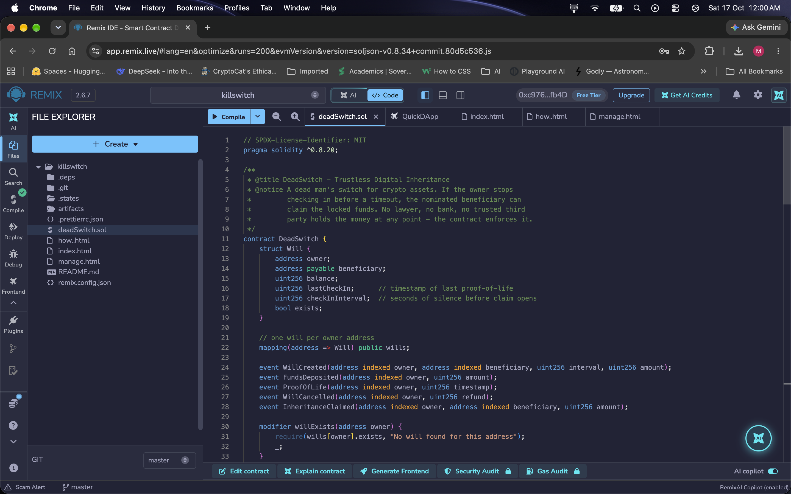
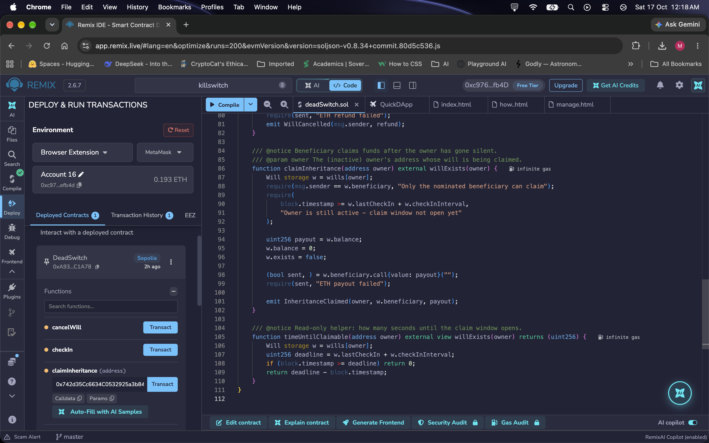
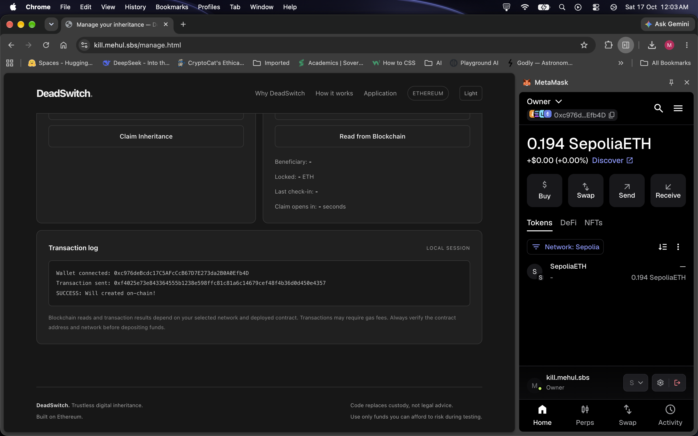
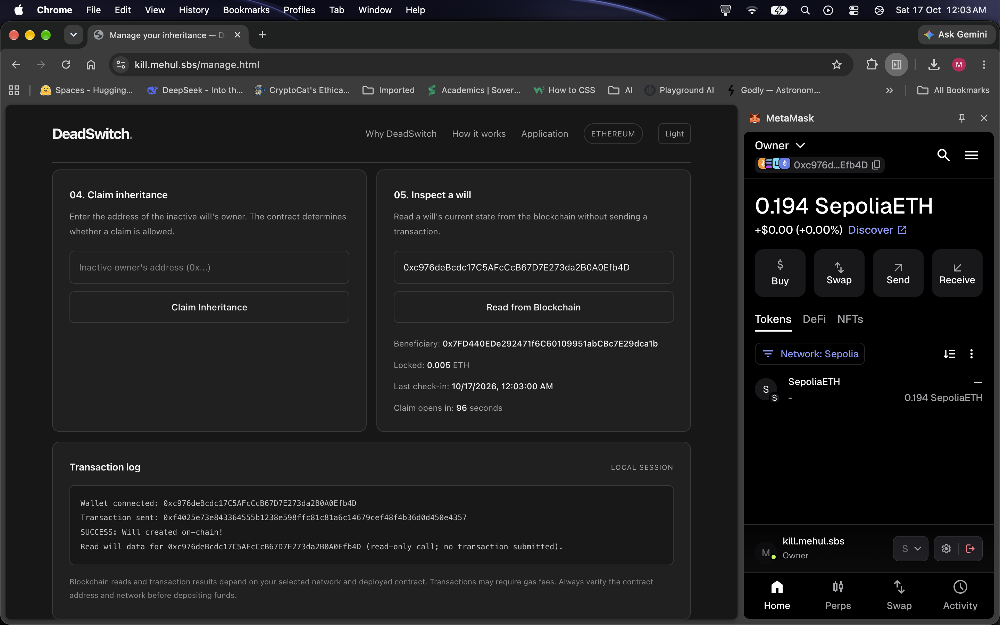
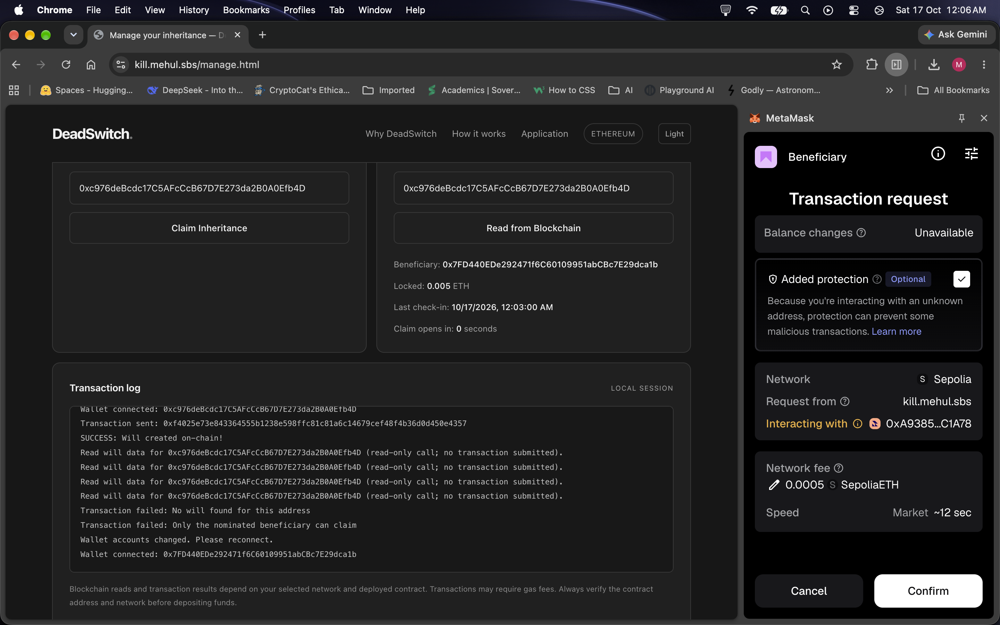
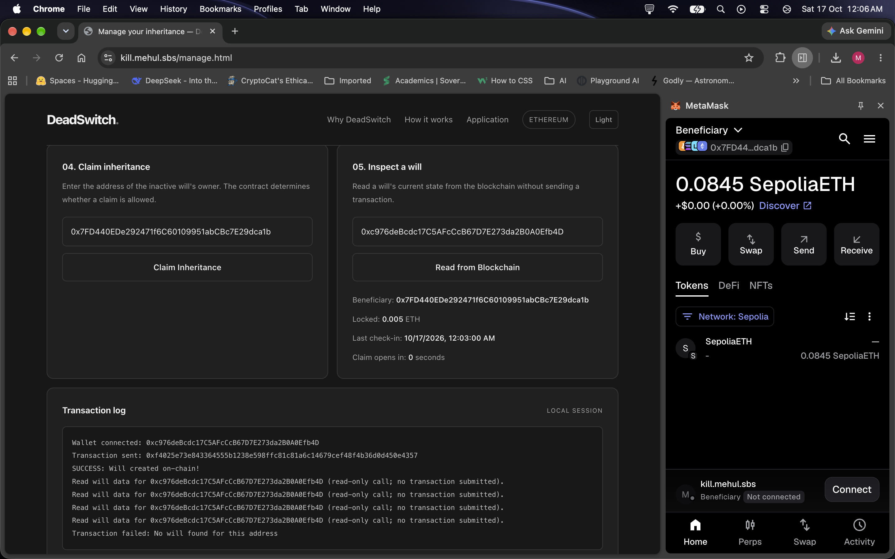
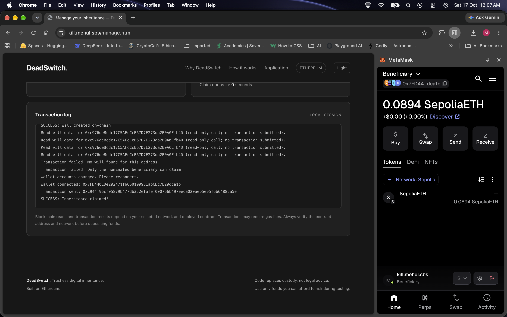
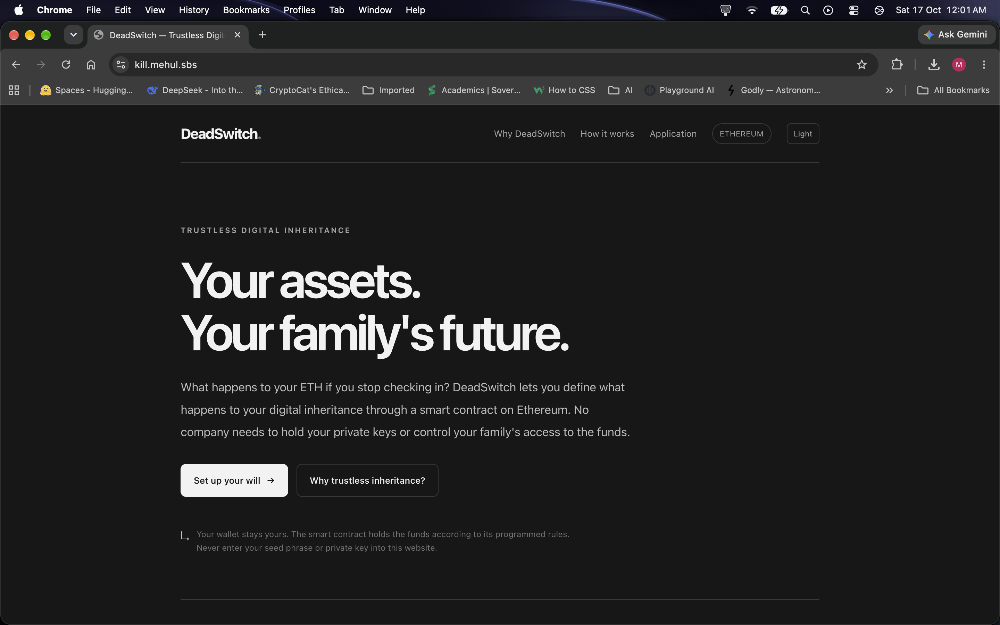

# DeadSwitch

## Decentralised digital inheritance DApp

DeadSwitch is an educational decentralised application (DApp) for
transferring ETH to a nominated beneficiary when the owner stops checking in.
The owner creates a will on an Ethereum-compatible network, chooses a
beneficiary and a check-in interval, and deposits ETH into the smart contract.
Every check-in resets the timer. When the interval expires, the beneficiary
can submit a claim, but the smart contract releases the funds only if the
caller is the nominated beneficiary.

The project addresses the problem of relying on a central company to hold
private keys, custody funds, and decide when an inheritance should be
released. The rules are stored and enforced by Solidity code instead.

This is an academic demonstration and testing project. It is not a legally
valid will, a financial product, or an audited production custody system.

## Deployment details

| Item | Value |
| --- | --- |
| Network | Sepolia testnet |
| Contract | `DeadSwitch` |
| Deployed address | `0xA9385c09c5eFFD3783Ff2705562c5e66126C1A78` |
| Solidity version | `0.8.20` |
| Browser library | ethers.js `6.7.0` |

The deployed address is also configured as `CONTRACT_ADDRESS` in
[`manage.html`](./manage.html). Always confirm that MetaMask is connected to
Sepolia before using the interface.

## Repository contents

| Path | Description |
| --- | --- |
| [`deadSwitch.sol`](./deadSwitch.sol) | Solidity smart contract. |
| [`index.html`](./index.html) | Landing page for the project. |
| [`how.html`](./how.html) | Plain-language explanation of the workflow. |
| [`manage.html`](./manage.html) | Frontend for MetaMask and contract interaction. |
| [`artifacts/DeadSwitch.json`](./artifacts/DeadSwitch.json) | Compiled ABI and contract artifact. |
| [`remix.config.json`](./remix.config.json) | Remix workspace configuration. |
| [`screenshots/`](./screenshots/) | Evidence of compilation, deployment, wallet connection, transactions, and blockchain reads. |

No private keys, seed phrases, passwords, or other credentials are included
in this repository. MetaMask signs transactions locally; the website never
asks the user to enter a private key or seed phrase.

## Application workflow

1. The owner connects MetaMask and creates a will by entering the beneficiary
   address, check-in interval, and initial ETH amount.
2. The contract stores the owner, beneficiary, balance, last check-in time,
   and interval.
3. The owner can check in to reset the timer, deposit additional ETH, or
   cancel the will while it is active.
4. After the interval expires, the beneficiary connects their own MetaMask
   account and submits the owner's address.
5. The contract checks the caller and the timeout. A valid beneficiary claim
   transfers the balance; an unauthorised claim is rejected.
6. The interface can read the beneficiary, locked balance, last check-in, and
   time remaining directly from the blockchain without sending a transaction.

## How to run the application

### Requirements

- A modern browser
- MetaMask
- Sepolia ETH for transaction fees and testing
- Python 3 or another local static file server

### Start the frontend

From the repository root, run:

```bash
python3 -m http.server 8000
```

Open <http://localhost:8000/> in the browser. The landing page links to the
management interface at <http://localhost:8000/manage.html>.

### Connect MetaMask

1. Install and unlock MetaMask.
2. Switch MetaMask to the **Sepolia test network**.
3. Open `manage.html`.
4. Click **Connect MetaMask**.
5. Select the owner account and approve the connection request.
6. Confirm that the page displays the connected address and wallet balance.

### Create and manage a will

1. In **Create a will**, enter a valid beneficiary address that is different
   from the owner account.
2. Enter a whole-number check-in interval of at least 60 seconds.
3. Enter an ETH amount greater than zero.
4. Click **Create Will** and confirm the transaction in MetaMask.
5. Use **Read from Blockchain** to verify the stored beneficiary, balance,
   last check-in, and claim countdown.
6. Use **Check In — Proof of Life** before the deadline to reset the timer.
7. After the timeout, connect the beneficiary account, enter the owner's
   address, and click **Claim Inheritance**.

## Test cases and observed results

The following cases were tested on the Sepolia deployment. The screenshots
listed in the evidence section provide the visual record of the flow.

| ID | Test input | Expected result | Observed result |
| --- | --- | --- | --- |
| T1 | Owner account connects to Sepolia through MetaMask. | The frontend shows the owner address and wallet balance. | Passed. The owner address and `0.19935 ETH` balance are displayed. |
| T2 | Owner creates a will with a valid beneficiary, interval, and ETH deposit. | The transaction is accepted and the will is stored on chain. | Passed. The transaction log shows `SUCCESS: Will created on-chain!`. |
| T3 | Frontend reads the owner's will address. | Blockchain data is displayed without submitting a transaction. | Passed. The interface displays the beneficiary, `0.005 ETH` locked balance, last check-in, and claim countdown. |
| T4 | Beneficiary account connects after the claim interval expires. | The beneficiary can submit a claim for the owner's address. | Passed. The beneficiary account is connected and the claim window shows `0 seconds`. |
| T5 | A non-beneficiary account calls `claimInheritance`. | The contract rejects the transaction. | Passed. The transaction log shows `Only the nominated beneficiary can claim`. |
| T6 | The nominated beneficiary calls `claimInheritance` after timeout. | The contract transfers the inheritance and closes the will. | Passed. The transaction log shows `SUCCESS: Inheritance claimed!`. |
| T7 | An owner tries to create a will with an invalid address, an interval below 60 seconds, or zero ETH. | The frontend or contract rejects the input. | Enforced by the application and contract validation. |
| T8 | A user without a will calls owner-only functions such as `deposit`, `checkIn`, or `cancelWill`. | The contract rejects the transaction. | Enforced by the `onlyOwner` modifier with `You have no will registered`. |

## Screenshot evidence

The screenshots are presented in the order of the demonstrated workflow.

### 1. Smart contract source and compilation

The contract is open in Remix and the Solidity source, compiler version, data
structure, and events are visible.



The Remix workspace also shows the project files and the compiled contract
ready for deployment.



### 2. Smart contract deployment

The deployed `DeadSwitch` contract is visible in Remix under **Deployed
Contracts** on the Sepolia network. The address shown is
`0xA9385c09c5eFFD3783Ff2705562c5e66126C1A78`.


### 3. Owner MetaMask connection and will creation

The owner account is connected to the application through MetaMask. The
frontend displays the owner address and wallet balance before the will is
created.


The owner then creates the will. The transaction log confirms the successful
on-chain operation.



### 4. Blockchain data displayed in the interface

The read-only lookup displays the beneficiary, locked ETH, last check-in time,
and the time remaining before the claim window opens.



### 5. Beneficiary connection and claim attempt

The beneficiary switches to the beneficiary MetaMask account after the
owner's check-in interval has expired.



The transaction request demonstrates the beneficiary claim flow. The
application log also records a failed claim from an unauthorised account.



### 6. Successful inheritance transaction

After the caller is the nominated beneficiary and the timeout has passed, the
claim succeeds. The transaction log shows `SUCCESS: Inheritance claimed!`.



### 7. Public application interface

The main page explains the purpose of DeadSwitch and links to the management
interface.



## Smart contract validation

The contract validates the following conditions:

- The beneficiary cannot be the zero address.
- The beneficiary cannot be the owner.
- The check-in interval must be at least 60 seconds.
- The initial deposit and later deposits must be greater than zero.
- Only an owner with an existing will can deposit, check in, or cancel.
- Only the nominated beneficiary can claim.
- A claim is possible only after the configured interval has elapsed.

The contract clears the will balance and marks the will as inactive before
sending the payout. It emits events for creation, deposits, check-ins,
cancellation, and successful claims so activity can be inspected on chain.

## Limitations

The timer measures inactivity; it does not prove death. The contract cannot
replace a legal will, verify identity, settle inheritance disputes, or
guarantee legal recognition. Sepolia ETH is test currency, but transactions
still require gas and blockchain transactions may be irreversible. Use small
amounts and verify the network and contract address before testing.
